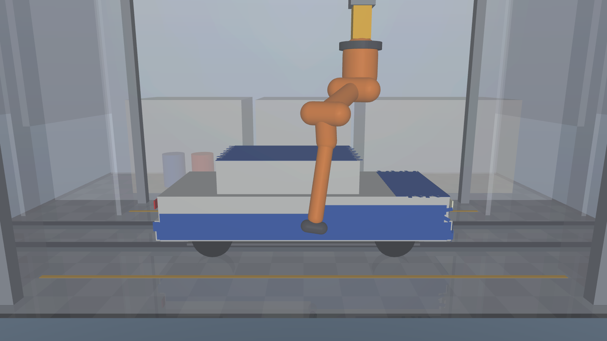

# Robotic Car Painting Cell — MuJoCo Simulation

**Name:** Vidya Sagar
**Software used:** MuJoCo 3.x (physics & rendering) with Python 3 (NumPy, SciPy, Matplotlib, imageio)
**Robot selected:** 6-axis industrial robot with ABB IRB 6700-150/3.20-class kinematics, mounted inverted on a 2-axis overhead gantry (X travel 6.4 m + Z lift 1.4 m) → 8 controlled axes

Practical assessment for the **Yuktii AI Labs — Robotics Simulation Intern** position.



---

## What it does

A complete, automatically planned painting cycle for a 4800 × 1900 × 1600 mm car body:

1. A conveyor carries the car from the entry zone into the 8 × 5 m paint booth.
2. The robot paints **7 surfaces** — roof, hood, front, right side, rear, left side, trunk lid — with raster (zig-zag) spray strokes.
3. Every motion is **collision-checked**; colliding moves are rejected and re-planned automatically.
4. The conveyor carries the painted car to the exit zone.

The cell layout follows the reference drawing: 12 × 8 m hall, 2 m entry zone, 8 × 5 m booth, 2 m exit zone, and service rooms (paint mixing, control, maintenance) along one side.

## Results

| Metric | Value |
|---|---|
| Surfaces painted | 7 (roof, hood, trunk, both sides, front, rear) |
| Spray path length | ≈ 126 m in 52 strokes |
| Paint coverage (film ≥ 50 % of nominal) | **97.2 %** (95.4–99.1 % per surface) |
| Film uniformity | 81–94 % of each surface within ±25 % of nominal thickness |
| Gun standoff while spraying | 250.1 ± 2.3 mm (target 250 mm) |
| Path accuracy (IK error) | < 0.5 mm on every surface |
| Collisions in final program | **0** (every sample checked) |
| Minimum clearance | 37 mm (robot ↔ car/booth/itself) |
| Rejected colliding motions | 5, all re-planned automatically |
| Joint speeds | all ≤ their limits |
| Cycle time | 434 s (316 s spraying, 92 s transfers, 26 s conveyor) |

Plots are in `output/plots/`, screenshots in `output/screenshots/`, all numbers in `output/results.json`.

## How to run

Requires Python 3.9+.

```bash
pip install -r requirements.txt

python plan_program.py       # 1. plan + verify the program   (~1 min)  -> output/program.npz, results.json, plots
python view_simulation.py    # 2. watch it live in the MuJoCo viewer
python take_screenshots.py   # 3. render report screenshots          -> output/screenshots/
python make_video.py         # 4. render the demo video (MP4)        -> output/demo_video.mp4
```

Just look at the cell: `python -m mujoco.viewer --mjcf models/paint_cell.xml`

Viewer keys: `SPACE` pause · `]` / `[` faster / slower · `R` restart · `C` toggle collision highlighting.

## Approach

### 1. Cell layout and robot choice
A single floor-mounted robot (reach ≈ 3 m) cannot reach both sides and the roof of a 4.8 m car. A turntable is not an option either: a rotating 4.8 × 1.9 m car sweeps a 5.2 m circle, which does not fit the 5 m booth. The robot is therefore mounted **upside-down on an overhead gantry**:

* **X axis (rail, 6.4 m)** moves the robot along the car.
* **Z axis (lift, 1.4 m)** was added after a reach study. With a fixed height, the robot either could not reach the lower doors or had to fold so tightly over the roof that the forearm hit its own shoulder.

Robot dimensions follow the ABB IRB 6700-150/3.20 class (approximate public values): shoulder offset 320 mm, upper arm 1280 mm, forearm 1590 mm, wrist 200 mm, plus a 350 mm rotary-bell spray gun.

### 2. Path planning (`paintcell/paths.py`)
For each surface a grid of parallel rays is cast at the car (`mj_ray`). Each hit gives a surface point and its outward normal. The gun target is

```
TCP = hit + 250 mm · n          spray axis = −n   (always perpendicular to the panel)
```

* Points are ordered into a **zig-zag raster**: 150 mm row pitch with a 300 mm spray fan gives 50 % overlap.
* Glass openings are masked; the gun switches off over them.
* Strokes extend **100 mm past every panel edge (overspray)**, which raised coverage from 95.0 % to 97.2 %.
* The TCP moves at a constant **0.4 m/s** while spraying, slowed locally only if a joint would exceed its speed limit.

### 3. Inverse kinematics (`paintcell/ik.py`)
* **Damped least-squares IK** on the MuJoCo Jacobian (`mj_jacSite`). A spray bell is axially symmetric, so roll about the spray axis is left free (5-D task).
* The 8 joints therefore give **3 redundant DOF**. These are resolved in the null space: the gantry carries the arm (rail follows the target's X, lift follows its height), so the six robot joints keep one arm shape across a whole surface.
* **Start-posture selection** (`paintcell/planner.py`): many IK solutions are generated for the first point of each surface. Each is then *tracked over the entire surface*, and the planner keeps the one that tracks every point accurately with the largest clearance. A posture that is fine at the first point can drive the elbow into the car later, so this whole-surface check matters.

### 4. Collision checking (`paintcell/collision.py`, `paintcell/rrt.py`)
* Robot links collide with the car, booth walls, gantry columns and floor, plus self-collision pairs (shoulder ↔ forearm, upper arm ↔ gun, …).
* **Planning check:** MuJoCo's contact detection with a 30 mm safety margin, about 8 µs per check.
* **Verification:** exact signed distances (`mj_geomDistance`) over every one of the ~8 000 program samples.
* **Transfers between surfaces** are tried in order, and the first collision-free option is used:
  1. a direct quintic joint move,
  2. a retract along the gun axis, then a joint move, then an approach,
  3. a detour via the park posture,
  4. an **RRT-Connect** joint-space planner with path shortcutting.

### 5. Verification and paint model (`paintcell/analysis.py`)
* Every spraying sample casts a ray from the *actual* TCP along the *actual* gun axis to measure the real standoff.
* **Film thickness** sums a Gaussian spray footprint (σ = fan / 4) over all samples and is normalised to the ideal flat-panel value.
* Results: coverage, uniformity, thickness maps, a clearance curve and joint trajectories.

## Repository layout

```
models/paint_cell.xml        MJCF: booth, gantry, robot, spray gun, car, conveyor
paintcell/
  cell.py                    model loading, joint bookkeeping, park posture
  paths.py                   ray-cast surface scanning, raster strokes, overspray
  ik.py                      damped-least-squares IK with null-space redundancy resolution
  collision.py               contact check (planning) + exact clearance (verification)
  rrt.py                     RRT-Connect joint-space planner
  planner.py                 builds the full time-stamped program
  analysis.py                collision sweep, paint deposition, film thickness
  render.py, playback.py     paint/spray drawing, replay, camera choreography
plan_program.py              step 1: plan + verify, save results and plots
view_simulation.py           step 2: interactive viewer
take_screenshots.py          step 3: report screenshots
make_video.py                step 4: demo video
output/                      results.json, plots/, screenshots/ (video is on Google Drive)
```

## Limitations and possible extensions

* **Simulation level.** The program is executed kinematically (joint positions are set from the plan). Dynamics, controller tracking and paint physics are not simulated; the film model is a geometric approximation.
* **Simplified car.** The body is built from primitives (boxes), so painting panels are flat. Curved panels would use the same method with mesh ray-casting and per-point normals.
* **Cycle time.** One robot needs ~7 min per car. A production line uses 4–8 robots in parallel; this cell would scale by adding a second gantry carriage or a robot on the opposite side.
* **Transfer quality.** RRT transfers are collision-free but not time-optimal; they could be smoothed with time-optimal path parameterisation.
